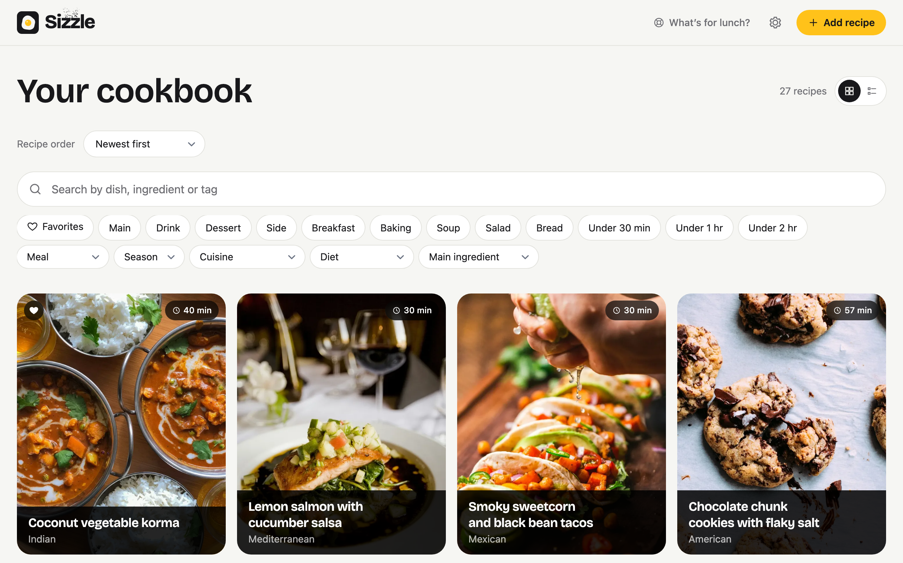

<p align="center">
  
</p>

<h1 align="center">Sizzle</h1>

<p align="center">
  <strong>Every recipe you love, minus the life story.</strong><br>
  A self-hosted cookbook. Share a recipe page from your phone and Sizzle keeps the ingredients,
  the steps and the best photo.
</p>

<p align="center">
  <a href="https://github.com/leemac/sizzle/releases/latest"></a>
  <a href="LICENSE"></a>
</p>

<p align="center">
  <a href="https://sizzle.mckinnon.dev">Website</a> ·
  <a href="#install">Install</a> ·
  <a href="docs/self-hosting.md">Self-hosting</a> ·
  <a href="https://github.com/leemac/sizzle/issues">Roadmap</a> ·
  <a href="CONTRIBUTING.md">Contributing</a>
</p>



> [!WARNING]
> Sizzle is very early in development. Expect rough edges and breaking changes between releases.

## Features

- **Share from anywhere.** One tap in your iPhone's share sheet sends a recipe page to Sizzle. Or
  paste several links at once, or the recipe text. Sharing guides cover iPhone, Android and computers.
- **YouTube too.** Share a cooking video and Sizzle reads the recipe from its description, or from
  the recipe page it links to. Open the original video from the method, with its duration,
  description timestamps and written-recipe link when available. Recipes that are only spoken
  in the video aren't supported yet.
- **Just the recipe.** Ingredients, steps and the best photo. No ads, pop-ups or life story.
- **No AI required.** Sizzle reads a site's recipe data, or you write the recipe yourself. Add an
  Anthropic API key to handle pages without recipe data and pasted text.
- **Fast to browse.** A photo grid or compact list with full-text search and filters for course,
  cuisine, diet, main ingredient and time.
- **Remember what you cook.** Save favorites and use “I made this” to track when and how often
  you cook each recipe.
- **Yours.** One small container with SQLite on your own server. No accounts, no tracking.

## Install

You need Docker with Compose on a home server, NAS, Raspberry Pi 4/5 or VPS. Images are published
for `amd64` and `arm64`.

1. Download the compose file and settings from the latest release:

   ```sh
   mkdir sizzle && cd sizzle
   curl -fsSLO https://github.com/leemac/sizzle/releases/latest/download/docker-compose.yml
   curl -fsSL https://github.com/leemac/sizzle/releases/latest/download/env.example -o .env
   ```

2. Edit `.env`:

   - `SIZZLE_API_TOKEN`: protects the share API. Generate one with `openssl rand -hex 32`.
   - `SIZZLE_HOSTS`: only if you'll open Sizzle at a domain name like `recipes.example.com`.
     IP addresses, bare hostnames and `.local`, `.lan`, `.home.arpa` and `.ts.net` names work
     without it.
   - `ANTHROPIC_API_KEY`: optional. Each AI extraction is a paid Claude request.

   Every other setting is explained in [.env.example](.env.example).

3. Start it:

   ```sh
   docker compose up -d
   ```

Open `http://<your-server>:3000` and choose **Setup** for a walkthrough, then **Share from your
phone** to add the iOS Shortcut.

> [!IMPORTANT]
> Sizzle has no login yet. Keep it on your home network or a private network like Tailscale, and
> read [SECURITY.md](SECURITY.md) before exposing it anywhere else.

To upgrade, run `docker compose pull && docker compose up -d`. Everything Sizzle stores lives in
the `sizzle-storage` volume, so back that up. [Self-hosting](docs/self-hosting.md) covers pinning a
version, upgrades, backups and building from source.

## Develop

```sh
bin/setup --seed                 # needs Ruby 3.3, Node 22 and libvips
bin/dev                          # http://localhost:3000
npx playwright install chromium  # once, for browser tests
bin/ci                           # all checks and tests
```

Sizzle is built in the open as a software factory: well-specified issues are worked by AI agents
and reviewed by people. Start with [AGENTS.md](AGENTS.md) for the architecture, conventions and
security rules, then [CONTRIBUTING.md](CONTRIBUTING.md) and [docs/factory.md](docs/factory.md).

## License

[AGPL-3.0](LICENSE). Run, modify and share Sizzle freely; if you offer a modified version as a
service, share your changes. Bundled assets such as the Bricolage Grotesque font keep their own
licenses: see [THIRD_PARTY_NOTICES.md](THIRD_PARTY_NOTICES.md).
